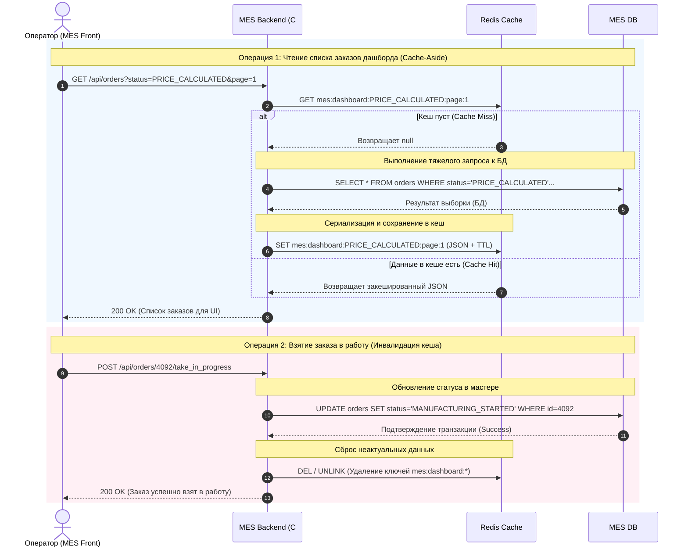

# Мотивация

Внедрение кеширования должно решить следующие бизнес и технические проблемы:

- Устранение задержек интерфейса (Latency): Время загрузки первой страницы дашборда MES снизится с нескольких секунд до десятков миллисекунд. Операторы смогут работать без зависаний.
- Разблокировка мастер-базы данных: Снятие 90% read-нагрузки (запросов на чтение списков заказов) с СУБД MES. Освободившиеся ресурсы CPU и I/O диска база данных сможет пустить на критичные операции записи — прием новых B2B-заказов и быструю смену статусов.
- Стабилизация B2B API: Разгрузка базы данных снизит вероятность возникновения взаимных блокировок (deadlocks) и таймаутов при сохранении результатов расчета тяжелых 3D-моделей, что напрямую улучшит пользовательский опыт клиентов и ускорит прохождение заказа по пайплайну.

# Предлагаемое решение

Для решения проблемы дашборда MES мы будем внедрять серверное кеширование (Server-side caching), используя in-memory хранилище (например, Redis).
Мы будем использовать паттерн Cache-Aside (Ленивая загрузка) в комбинации с принудительной инвалидацией при записи.

Почему выбран именно Cache-Aside:

- Идеально подходит для сложных выборок: Нам нужно кешировать не просто одиночные объекты (заказ №123), а агрегированные списки с пагинацией и фильтрами. Cache-Aside позволяет легко кешировать весь результат готового HTTP-ответа или SQL-выборки целиком.
- Отказоустойчивость: Если кластер Redis временно упадет, система просто продолжит работать напрямую с базой данных (хоть и медленнее). Приложение не сломается.
- Эффективность при всплесках чтения: Если 50 операторов одновременно обновляют страницу, только первый запрос (Cache Miss) дойдет до базы данных, а остальные 49 мгновенно получат данные из кеша (Cache Hit).

Почему остальные паттерны покажут себя хуже:

- Write-Through (Сквозная запись):
  - Почему не подходит: Write-Through отлично работает для простых пар «ключ-значение» (когда мы кешируем профиль пользователя). Но кешировать пагинированные списки таким образом невероятно сложно. Если приходит новый заказ, нам пришлось бы не просто обновить кеш, а извлечь закешированную «Страницу 1», вставить заказ наверх, удалить последний элемент, перенести его на «Страницу 2» и так далее. Это алгоритмически сложно, чревато багами и состоянием гонки (Race Conditions). Проще сбросить кеш (как в Cache-Aside) и позволить следующему чтению пересобрать актуальный список.
- Refresh-Ahead (Упреждающее обновление):
  - Почему не подходит: Этот паттерн маскирует задержки БД ценой предоставления устаревших данных. Если кеш обновляется раз в 5 секунд, то целых 5 секунд операторы будут видеть на экране «заказы-призраки», которые уже кто-то взял в работу. В условиях конкурентной сдельной оплаты труда операторов задержка в обновлении состояния даже на пару секунд абсолютно неприемлема. Нам нужна строгая консистентность, которую дает только немедленная инвалидация при записи.

# Диаграмма последовательности действий для операции чтения списка заказов и записи об изменении статуса заказа

# Cтратегия инвалидации кеша

Для дашборда MES мы будем использовать гибридную стратегию: Программную инвалидацию по событию в качестве основной, с добавлением короткого TTL (Time-To-Live) в качестве страховки.

# Сравнительный анализ стратегий

| Стратегия                                  | Подходит / Не подходит            | Обоснование для системы MES                                                                                                                                                                                                                                                                                                                                                                                                  |
| ------------------------------------------ | --------------------------------- | ---------------------------------------------------------------------------------------------------------------------------------------------------------------------------------------------------------------------------------------------------------------------------------------------------------------------------------------------------------------------------------------------------------------------------- |
| Программная инвалидация (Выбранная)        | Идеально подходит                 | Позволяет гибко управлять кешем на уровне бизнес-логики. Как только оператор нажимает «Взять в работу» (происходит событие бронирования заказа), система программно инвалидирует кеш списка PRICE_CALCULATED. Это гарантирует, что следующий обновленный дашборд у всех остальных операторов уже не будет содержать этого заказа.                                                                                            |
| Временная инвалидация                      | Категорически не подходит         | Порождает конфликты и фрустрацию пользователей (Race Conditions). Если установить время жизни кеша даже на 10 секунд, то в течение этих 10 секунд операторы будут видеть заказы, которые уже кто-то взял. При попытке взять такой заказ они будут получать технические ошибки.                                                                                                                                               |
| Инвалидация по ключу                       | Не подходит (как самостоятельная) | Эта стратегия хороша для единичных сущностей (например, профиль конкретного заказа order:4092). Но дашборд MES запрашивает пагинированные списки (например, page:1). Изменение статуса одного заказа ломает всю структуру страниц. Инвалидировать списки простым поиском по ключу одного товара не получится, здесь нужна именно программная логика очистки связанных списков.                                               |
| Инвалидация на основе изменений / запросов | Подойдет только частично          | Эти стратегии предполагают сброс кеша при любом обновлении данных. Однако в MES могут происходить фоновые изменения (например, процент загрузки 3D-модели), которые не влияют на факт доступности заказа для оператора. Использование чисто программной инвалидации позволяет точечно реагировать только на критичные бизнес-события (смена статуса), избегая лишней нагрузки на перестроение кеша при минорных обновлениях. |
